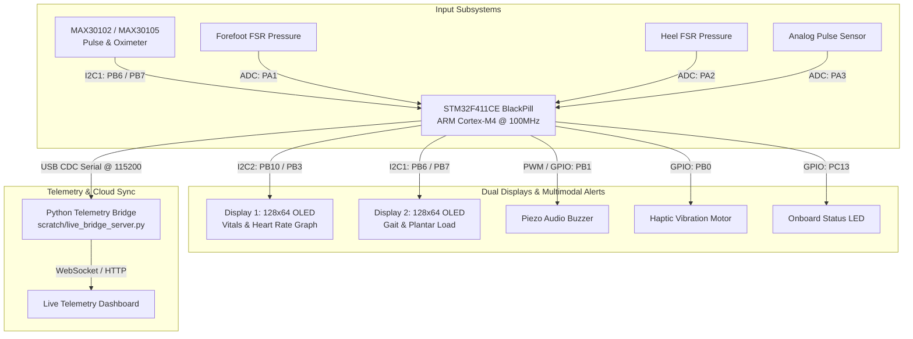

# 🩺 SoleGuard: Multi-Sensor Medical & Gait Monitoring Wearable

[](https://www.st.com/)
[](https://platformio.org/)
[](https://www.arduino.cc/)
[](https://python.org/)
[](https://opensource.org/licenses/MIT)

**SoleGuard** is an embedded biomedical and gait-analysis wearable system powered by the **ARM Cortex-M4 STM32F411CE (WeAct BlackPill)** microcontroller. The device features dual independent hardware I2C buses driving dual OLED displays, an optical PPG heart-rate / SpO2 pulse engine, dual-zone plantar pressure sensors (FSR), and multimodal alerts (buzzer and haptic vibration motor).

---

## 📌 System Architecture



---

## ✨ Features

- **Dual Hardware I2C Architecture**:
  - `I2C1` (`PB6`/`PB7`): Primary bus for MAX30102 PPG pulse engine and secondary OLED display.
  - `I2C2` (`PB10`/`PB3`): Dedicated hardware bus instance for primary OLED display to maximize frame refresh rates without bus contention.
- **Biomedical PPG Pulse Engine**:
  - Embedded peak-detection and infrared amplitude filtering for live BPM calculation and blood oxygenation tracking.
- **Plantar Pressure & Gait Analysis**:
  - Forefoot and Heel Force Sensing Resistors (FSRs) with dynamic thresholding (`FSR_THRESHOLD 2000`) to detect heel-strike, foot-flat, and toe-off transitions.
- **Multimodal Feedback**:
  - Audio and haptic alerts trigger when physiological vitals or gait parameters exceed clinical safety thresholds.
- **Python Serial & WebSocket Bridges**:
  - Includes real-time Python telemetry bridges and live terminal waveform monitors in `scratch/`.

---

## 🔌 Hardware Pinout

| Peripheral | STM32 Pin | Function / Description |
| :--- | :--- | :--- |
| **I2C1 SCL** | `PB6` | Primary I2C Clock (MAX30102, Display 2) |
| **I2C1 SDA** | `PB7` | Primary I2C Data |
| **I2C2 SCL** | `PB10` | Secondary I2C Clock (Display 1) |
| **I2C2 SDA** | `PB3` | Secondary I2C Data |
| **Forefoot FSR** | `PA1` | Analog ADC Input (Forefoot weight) |
| **Heel FSR** | `PA2` | Analog ADC Input (Heel strike) |
| **Pulse Sensor (Aux)**| `PA3` | Analog ADC Input |
| **Audio Buzzer** | `PB1` | Alert sounder |
| **Vibration Motor** | `PB0` | Haptic feedback driver |
| **Onboard LED** | `PC13` | Heartbeat / system state indicator |

---

## 🚀 Building & Flashing

### 1. PlatformIO CLI / VSCode
1. Install [PlatformIO IDE](https://platformio.org/) (VSCode extension or CLI).
2. Connect your **ST-Link v2** to the STM32 BlackPill (SWDIO, SWCLK, 3.3V, GND).
3. Build the firmware:
   ```bash
   pio run
   ```
4. Flash using ST-Link:
   ```bash
   pio run --target upload
   ```

### 2. Live Telemetry Monitor
Connect the STM32 USB-C port to your computer, then launch the telemetry monitor:
```bash
python3 scratch/terminal_monitor.py
```
Or start the live WebSocket bridge:
```bash
python3 scratch/live_bridge_server.py
```

---

## 📁 Repository Structure

```text
├── platformio.ini                      # Board flags, ST-Link upload, and library dependencies
├── .gitignore                          # Build artifacts and cache exclusions
├── src/
│   ├── main.cpp                        # Active SoleGuard multi-sensor firmware
│   └── main_soleguard.cpp.bak          # Baseline reference firmware
├── include/
│   └── README                          # Header include documentation
├── lib/
│   └── README                          # Private project libraries
└── scratch/
    ├── terminal_monitor.py             # CLI serial stream monitor
    ├── live_bridge_server.py           # WebSocket live streaming bridge
    ├── telemetry_bridge.py             # Telemetry parsing utility
    └── main_integrated_backup.cpp      # Experimental backup sketch
```
